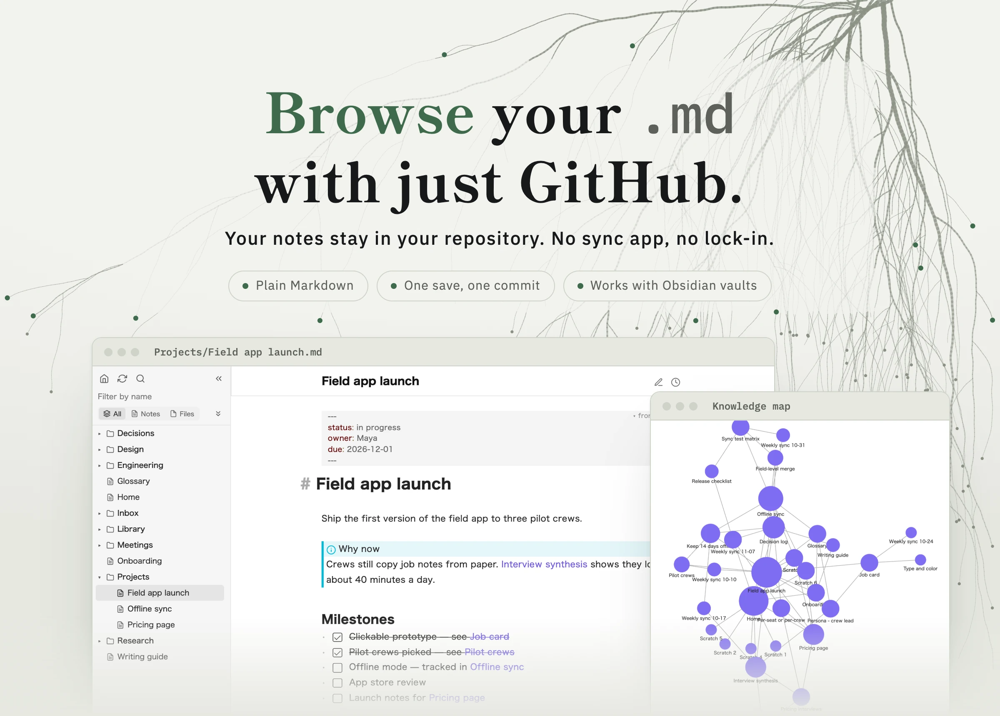
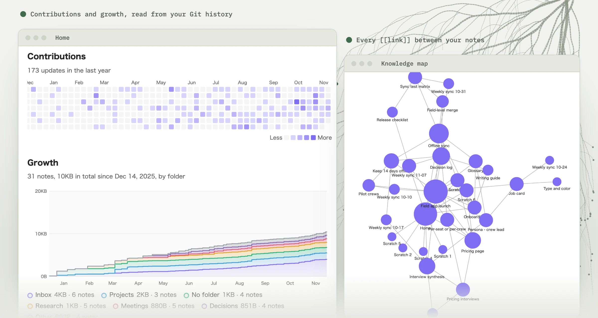

<p align="center">
  <picture>
    <source media="(prefers-color-scheme: dark)" srcset="docs/brand/rootlore-logo-horizontal-dark.png">
    
  </picture>
</p>

<p align="center"><strong>Your knowledge. Rooted in Git.</strong><br>Read, search, and edit the Markdown notes in your GitHub repository.</p>

<p align="center">
  <a href="https://github.com/tanakaisworking/rootlore-releases/releases/latest"><strong>Download for macOS</strong></a> ·
  <a href="https://rootlore.app/v/">Open the web app (beta)</a> ·
  <a href="https://github.com/tanakaisworking/rootlore/issues/new">Send feedback</a>
</p>

<picture>
  <source media="(prefers-color-scheme: dark)" srcset="docs/readme/hero-dark.webp">
  
</picture>

Rootlore is an open-source Mac app that turns a GitHub repository of Markdown notes into a workspace. Your repository stays the source of truth: no sync app, no export step. Connect it with your own GitHub token, and the app talks to GitHub directly. A web version is in open beta, and anyone with a GitHub account can try it.

## Why Rootlore

**Your notes stay yours.** Switching note apps usually means moving your data. With Rootlore, your Markdown and its full history stay in your own repository, readable in Obsidian, on GitHub, or in any editor. If you stop using Rootlore, nothing is left behind.

**Nothing to sync.** Every device opens the same repository. There is no sync service to pay for, no conflicted copies, and no vault to keep in step across machines.

**Built for notes that AI writes.** When agents and scripts write into your notes, you need to see what changed. Every save is a Git commit, and the home screen starts with how your knowledge changed, not with a blank page.

## See your knowledge grow

<picture>
  <source media="(prefers-color-scheme: dark)" srcset="docs/readme/home-dark.webp">
  
</picture>

The home screen reads your Git history: a year of contributions, how each folder grew, and the latest changes. The knowledge map draws every `[[link]]` between your notes, so the hubs of your thinking stand out.

## What you can do

- Read Markdown as it is: frontmatter, `[[wikilinks]]`, backlinks, callouts, and images.
- Search across every note. Rootlore keeps a local copy in your browser for full-text search, so it doesn't depend on GitHub's code search.
- See your activity, growth, recent changes, and note connections on the home screen.
- Open a note's history on GitHub to see who changed what, and when.
- Edit a note in place. Saving creates one commit in GitHub. If the note changed remotely since you opened it, Rootlore warns you instead of overwriting it.
- Keep an in-browser draft while editing. Close the tab or navigate away without losing your work.
- Drag files between folders. If a move would conflict, Rootlore returns the file and tells you.
- Use familiar shortcuts: `⌘Z` to undo a move, `⌘,` for settings, and more.
- Let AI tools search and read your notes through the Mac app's built-in MCP server.
- Work from the CLI when you want to automate.

## Getting started

### On your Mac (recommended)

1. Download Rootlore from the [latest release](https://github.com/tanakaisworking/rootlore-releases/releases/latest) and move it to Applications.
2. On GitHub, create a fine-grained token: Settings → Developer settings → Personal access tokens → Fine-grained tokens. Under Repository access, choose "Only select repositories" and pick your notes repository. Under Repository permissions, set Contents to "Read and write".
3. Open Rootlore, paste the token under "Use a token", and enter the repository as `owner/repo`.

The token is stored in the macOS Keychain, and the app sends your notes only to and from GitHub. You can revoke the token on GitHub at any time.

### In the browser (beta)

1. Open [Rootlore](https://rootlore.app/v/) and sign in with GitHub.
2. Choose the repository that holds your notes. If your Obsidian vault is already on GitHub, pick that repository.
3. Install the GitHub App on that repository only. If you installed it on several repositories, Rootlore asks which one to open. You can switch later on the Account page.

The App requests read and write access to Contents for the repositories you install it on, and no others. Rootlore reads and writes only the one you open. You can remove the App from any repository in your GitHub settings. Sign-in and repository access are separate steps, so you can see exactly what you are granting.

### On the command line

The Mac app includes the `rootlore` command and links it to `~/.local/bin/rootlore` when nothing else is there. Updating the app updates the command.

Without the app, download `rootlore-macos-aarch64` from a `cli-v*` [release](https://github.com/tanakaisworking/rootlore-releases/releases), save it as `~/.local/bin/rootlore`, and make it executable. `rootlore update` installs newer versions; it checks the signature before replacing itself.

Run `rootlore login` to sign in through your browser, then `rootlore help` for the commands.

## Data and permissions

- Rootlore does not store note bodies on its servers. Notes travel only between GitHub and your browser.
- Rootlore keeps only what it needs for sign-in, and the name of the repository you chose, inside your encrypted session cookie. There is no note database.
- On the web version, the operator can technically access the repository you connect. We minimize permissions and do not store notes server-side. If you prefer that no server is involved, use the Mac app with your own token.
- You can revoke access from GitHub at any time.
- The app sends error reports (the error type, the stack trace, and browser error messages) to help fix problems. Note contents, file names, and page locations are removed before they leave Rootlore's server. Turn it off in Settings → Error reports. Self-hosted instances send nothing unless they set their own Sentry DSN.

## How it works

- The interface and editor are built on a fork of SilverBullet (MIT).
- The server runs on Cloudflare Workers. Its only jobs are GitHub sign-in and relaying GitHub API requests.
- Notes are read and written through a GitHub App. The browser keeps note bodies in IndexedDB for search and the knowledge map.
- Rootlore talks to GitHub only when you open it, refresh, or save. There is no background sync daemon.

See [docs/architecture.md](docs/architecture.md) for the design.

## Roadmap

- Per-note history, diffs, and restore.
- Grouped change events that explain what changed and why.
- Image and attachment uploads.
- Better mobile reading and a faster knowledge map.

## Development

Node 24 is required.

```sh
git clone https://github.com/tanakaisworking/rootlore.git
cd rootlore
npm ci
npm ci --prefix silverbullet
npm run dev
```

The app runs at http://127.0.0.1:8790. `npm run dev` uses `gh auth token`, so run `gh auth login` first, and set `DEV_GITHUB_REPO=owner/repo` to the repository to open. Worker tests: `npm test`. SilverBullet tests: `npm --prefix silverbullet test`. See [CONTRIBUTING.md](CONTRIBUTING.md) before you send a change.

## Feedback

Open a [GitHub Issue](https://github.com/tanakaisworking/rootlore/issues) or use the paper-plane button in the app's sidebar.

Brand assets live in [docs/brand](docs/brand/README.md).

## License

[MIT](LICENSE). The interface is built on [SilverBullet](https://github.com/silverbulletmd/silverbullet) (MIT); its notice is in [silverbullet/LICENSE.md](silverbullet/LICENSE.md).
